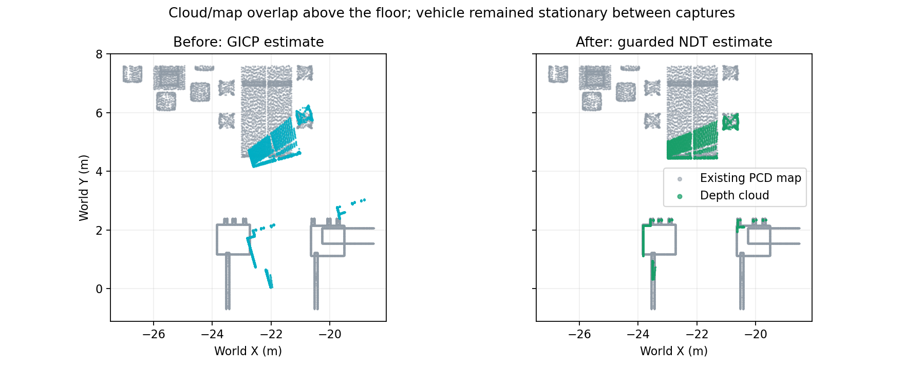
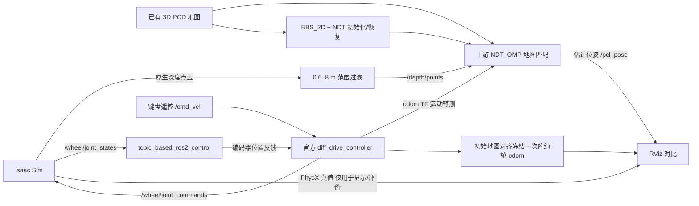
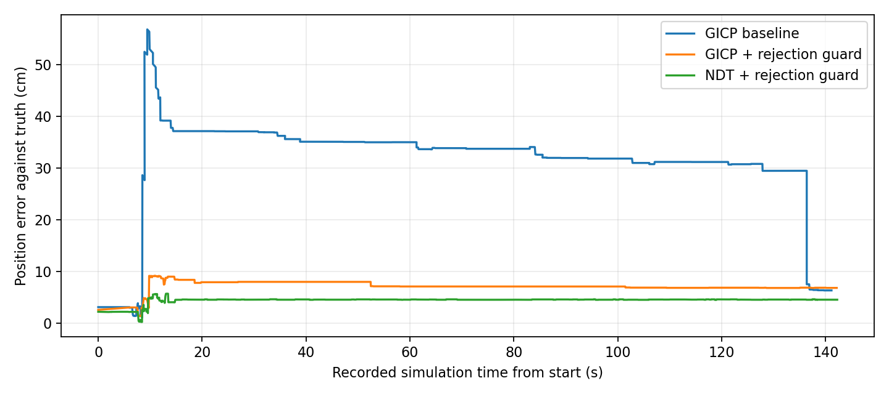

# Isaac Depth Localization

在 **Isaac Sim + ROS 2 Humble** 中，使用已有 **3D PCD 地图、深度相机点云和轮编码器里程计**，估计差速小车在地图中的位置与朝向，并在 RViz 中与独立仿真真值进行对比。

面向 organization：`ICPROJECT2026`。建议仓库名：`isaac-depth-localization`。

项目复用现有开源定位和控制软件：**NDT_OMP 地图匹配 + BBS_2D/NDT 全局初始化 + 官方 diff_drive_controller 轮 odom**。本仓库提供场景覆盖层、相机/关节接线、启动配置、范围过滤、显示适配和实验结果；没有另写点云配准或轮里程计积分算法。

> 当前是仿真实验项目，已完成短记录回放比较和静止对齐检查。长距离运行、复杂动态遮挡、完整失定位恢复及真实相机部署尚需验证。仓库不含 Isaac Sim 安装包、原始场景资源、183 MB 点云地图或 rosbag；资源准备方法见下文。



## 目录

- [功能与当前状态](#功能与当前状态)
- [系统结构与数据流](#系统结构与数据流)
- [环境与依赖](#环境与依赖)
- [安装和资源配置](#安装和资源配置)
- [启动与遥控](#启动与遥控)
- [RViz、话题与 TF](#rviz话题与-tf)
- [关键参数](#关键参数)
- [验证结果与边界](#验证结果与边界)
- [地图导出与文件格式](#地图导出与文件格式)
- [常见问题](#常见问题)
- [仓库结构](#仓库结构)
- [协作、组织导入与许可](#协作组织导入与许可)

## 功能与当前状态

| 功能 | 状态 | 说明 |
|---|---|---|
| 读取现有 3D PCD 地图定位 | 已接入 | 不在定位过程中重新建图 |
| 深度相机生成 PointCloud2 | 已接入 | Isaac 原生 ROS 2 Camera Helper 生成原始点云 |
| 深度和点云量程过滤 | 已接入 | 轴向 0.6–8 m，超出范围置 NaN |
| 实际轮角反馈 odom | 已接入并做初步标定 | 后两主动轮参与差速运动学，前从动轮不参与积分 |
| 轮 odom 预测 + NDT 地图校正 | 已接入 | 使用时间戳对应的 odom TF 预测，不重复积分速度 |
| 全地图搜索初始化 | 已接入、启动成功 | BBS_2D 候选 + 3D NDT 验证，多次一致后接受 |
| 匹配拒绝保护 | 已接入 | 根据 fitness 和相对于 odom 预测的校正量判断 |
| 失定位恢复监督器 | 已接线，完整动态测试待做 | 接线不代表所有退化场景都能恢复 |
| 估计、纯轮 odom、真值三路 RViz 对比 | 已接入 | 绿色、蓝色、红色 |
| IMU 融合 | 未接入 | 当前配置关闭 IMU 和预积分 |
| 椅子/人员语义剔除、动态物体过滤 | 未实现 | 当前地图仍含场景中导出的物体 |
| 自主导航、规划与避障 | 不在当前交付范围 | 当前通过键盘遥控人工测试 |

## 系统结构与数据流



**这里的“融合”具体指：**先用轮 odom 的相对运动得到这一帧的位姿预测，再把它作为深度点云匹配地图的初值。匹配通过质量检查后，用结果校正地图中的位置；匹配被拒绝时，可暂时依靠轮 odom 输出预测。当前没有额外的 EKF，也没有接入 IMU。

**真值保持独立：**`/ground_truth/pose` 来自 PhysX 刚体世界位姿，用于 RViz 和误差评价，不输入定位器。历史轮距标定使用过真值进行离线参数拟合；它与运行时使用真值定位是两件不同的事。

## 环境与依赖

### 已使用的环境

| 项目 | 已使用配置 |
|---|---|
| 系统 | Ubuntu 22.04 x86_64 |
| ROS | ROS 2 Humble，安装于 `/opt/ros/humble` |
| Isaac Sim | 源码构建 6.1.0-rc.26；课程截图的 6.0.1 不能视为本项目实际版本 |
| Python | 系统 ROS Python 3.10；Isaac 自带 Python 3.12，分别使用 |
| GPU | NVIDIA RTX 4070 Laptop，8 GB 显存 |
| ROS 通信 | `ROS_DOMAIN_ID=26`，`rmw_fastrtps_cpp`，`ROS_LOCALHOST_ONLY=0` |
| 单位与坐标 | 米、Z 向上，`map` 与导出 USD 世界坐标一致 |

这张表记录实验环境，不是最低硬件要求。其他 Isaac Sim 版本的扩展名、OmniGraph 节点及 Python 接口可能需要适配。

### 上游组件

| 组件 | 用途 | 版本记录 |
|---|---|---|
| [lidar_localization_ros2](https://github.com/rsasaki0109/lidar_localization_ros2) | 地图定位、粗定位、生命周期和恢复监督器 | commit `87b991693acbf00b64300a3e28e158ba95cbe220` |
| [ndt_omp_ros2](https://github.com/rsasaki0109/ndt_omp_ros2) | OpenMP NDT/GICP 后端 | commit `0cc1621d5eab886569f6e7e36d115fcad894cd72` |
| [ros2_control / diff_drive_controller](https://control.ros.org/humble/doc/ros2_controllers/diff_drive_controller/doc/userdoc.html) | 差速控制和编码器里程计 | 实验为 controller_manager 2.54.3、diff_drive_controller 2.54.1 |
| [topic_based_ros2_control](https://github.com/PickNikRobotics/topic_based_ros2_control) | ROS 关节话题硬件接口 | 实验为 0.2.0 |
| RViz、teleop_twist_keyboard | 可视化和人工遥控 | ROS Humble 发行包 |

两个源码依赖锁定在 [`dependencies.repos`](dependencies.repos)，不把第三方源码、构建目录和二进制包复制进本仓库。APT 安装使用可用的 Humble 包，版本可能与历史实验不同；复现实验时请记录实际安装版本。

## 安装和资源配置

### 1. 克隆本仓库

仓库在组织中创建并推送后：

```bash
git clone https://github.com/ICPROJECT2026/isaac-depth-localization.git
cd isaac-depth-localization
```

以下所有命令均在本仓库根目录执行。先安装 ROS 2 Humble 和 Isaac Sim；本仓库不负责安装这两个平台。

### 2. 安装 ROS 与构建依赖

```bash
sudo apt update
sudo apt install -y \
  git build-essential cmake python3-dev pybind11-dev libpcl-dev \
  python3-colcon-common-extensions python3-vcstool python3-rosdep \
  python3-numpy python3-scipy python3-yaml python3-pil \
  ros-humble-rviz2 ros-humble-teleop-twist-keyboard \
  ros-humble-ros2-control ros-humble-ros2-controllers \
  ros-humble-topic-based-ros2-control ros-humble-rosbag2 \
  ros-humble-rmw-fastrtps-cpp
```

若系统尚未初始化 rosdep，先执行一次 `sudo rosdep init`，再执行 `rosdep update`；已经初始化时不要重复 init。

```bash
bash scripts/fetch-upstream.sh
source /opt/ros/humble/setup.bash
rosdep install --from-paths ros_ws/src --ignore-src -r -y --rosdistro humble
cd ros_ws
colcon build --symlink-install --packages-up-to lidar_localization_ros2 \
  --cmake-args -DCMAKE_BUILD_TYPE=Release -DPython3_EXECUTABLE=/usr/bin/python3
cd ..
```

必须使用 Release 构建。安装 `pybind11-dev` 和 `python3-dev` 后，构建日志应包含 `bbs_cpp` 与 `g2_ndt_score` 编译提示；本配置启用 C++ 搜索后端和 NDT 候选评分，需要检查这两个模块实际生成。

`fetch-upstream.sh` 不重置已有 checkout。若复用已有 `ros_ws`，请核对两库 `git rev-parse HEAD` 与 `dependencies.repos` 是否一致。不要直接跟随主分支最新代码来声称复现本次实验。

### 3. 准备场景和地图资源

| 资源 | 放置建议 | 是否随 Git 提供 |
|---|---|---|
| 原始 collected 场景及整套材质/贴图 | `assets/scene/Collected_final_wheeltec_with_scene/` | 否，约 2 GB |
| 当前裁剪、去顶板的 2 cm PCD | `assets/maps/room.pcd` | 否，183,017,078 字节、11,438,552 点 |
| BBS 搜索辅助栅格 | `assets/maps/room.yaml`、`room.pgm` | 是，与当前 PCD 配套 |
| 比例、相机和轮关节修改覆盖层 | `config/localization_scene.template.usda` | 是 |

本项目仅提供代码和配置，**不打包或分发原始场景与 PCD 地图**。运行时使用本机已有资源，通过下一步传入绝对路径即可，无需复制到仓库。原始场景必须保留完整 collected 目录，不能只保留根 USD 文件。

本地资源要求见 [`docs/ASSETS.md`](docs/ASSETS.md)；[`assets/manifest.json`](assets/manifest.json) 仅保留历史实验资源的哈希记录，不包含资源内容。

### 4. 生成本地配置

把下面的示例路径替换为自己的安装和资源位置：

```bash
python3 scripts/configure.py \
  --isaac-root "$HOME/isaacsim/_build/linux-x86_64/release" \
  --scene "$PWD/assets/scene/Collected_final_wheeltec_with_scene/final_wheeltec_with_scene.usd" \
  --map "$PWD/assets/maps/room.pcd"
```

此命令生成 `.env.local`、`runtime/*.local.yaml` 和 `runtime/localization_scene.local.usda`，均已被 Git 忽略。本地覆盖层引用原始场景，不覆盖源场景；仿真启动时会保存对本地覆盖层的接口接线。

`--occupancy` 可指定配套的辅助栅格 YAML；`--ros-overlay` 可指定另一个已构建工作空间的 `install/setup.bash`。默认使用本仓库 `ros_ws/install/setup.bash`。更换地图时必须同时准备与它一致的辅助栅格，不能只替换 PCD 而继续使用本房间的栅格。

迁移仓库位置、修改本地路径或修改 `config/` 定位参数后，应重新运行 configure。不要把本地路径写回公共 YAML，不要把 `.env.local` 提交到 Git。

### 5. 检查整理版文件

```bash
python3 scripts/check-repository.py
```

此检查针对 Python/Bash 语法、YAML/URDF、依赖锁定、文档本地链接、大文件和本机路径。它不启动 Isaac、不控制车辆，也不能替代完整仿真验证。整理版的路径生成检查与历史运行精度验证分开记录，见 [`docs/VALIDATION.md`](docs/VALIDATION.md)。

## 启动与遥控

每个终端先进入仓库根目录。按下面顺序启动；不需要手动设置 `LD_LIBRARY_PATH`，脚本会分开配置系统 ROS 和 Isaac 内置库。

| 终端 | 命令 | 等待条件/作用 |
|---|---|---|
| 1 | `bash scripts/run.sh simulation` | 等待场景加载和 `LOCALIZATION_SCENE_READY`，仿真进入 Play |
| 2 | `bash scripts/run.sh wheel` | 两个官方控制器成功激活，odom 随仿真时间更新 |
| 3 | `bash scripts/run.sh localization` | 等待 `Localized from a map search.`，开始输出地图定位 |
| 4 | `bash scripts/run.sh rviz` | 自动加载已保存的显示配置 |
| 5 | `bash scripts/run.sh teleop` | 焦点保持在该终端，手动驾驶 |

冷启动可能需要几十秒，初始化期间建议保持车辆静止。全局搜索也可能失败；初始化日志和 `/alignment_status` 比“箭头出现了”更能说明当前状态。

遥控默认线速度 `0.1 m/s`、角速度 `0.3 rad/s`：

| 按键 | 动作 |
|---|---|
| `i` | 前进 |
| `,` | 后退 |
| `j` / `l` | 左转 / 右转 |
| `u` / `o` | 左前 / 右前弧线 |
| `k` | 停车 |
| `Ctrl+C` | 退出该终端程序 |

程序不自动发起测试路线。若需要录制，在第六个终端运行 `bash scripts/run.sh record`，用 Ctrl+C 结束并关闭 bag 后再读取数据。深度点云数据量大，录制结果位于被忽略的 `data/`。

关闭时先停车、退出遥控，再停止定位、控制器和 RViz，最后退出仿真。重启 Isaac 会重置仿真时间，应同时重启其他 ROS 进程以清除旧时间/TF 缓存。不要同时运行原实验目录的旧定位器或控制器。

## RViz、话题与 TF

### RViz 中的含义

| 显示 | 含义 |
|---|---|
| 灰色点云 | 现有静态 PCD 地图 |
| 青色点云 | 使用当前估计 TF 投入地图坐标系的实时深度点云 |
| 绿色箭头/轨迹 | NDT + 轮 odom 的定位输出 |
| 红色箭头 | Isaac PhysX 的车身世界位姿真值 |
| 蓝色箭头/轨迹 | 初始化时冻结一次地图对齐后，独立累积的纯轮 odom |

蓝色显示适配器在连续 8 次匹配状态良好后冻结一次 `map → odom` 对齐，后续点云校正不再改变蓝色参考。它不订阅真值，不重新积分轮角，也不向定位器反馈。蓝色初始对齐仍包含初始化误差，因此不是没有误差的独立全局定位器。

RViz `Fixed Frame` 使用 `map`。观察三维地图可选择 `Orbit`：左键旋转、中键平移、滚轮缩放。地图点云不动、实时相机点云随车辆看到不同表面，是正常现象。

### 主要话题

| 话题 | 类型 | 用途 |
|---|---|---|
| `/clock` | `rosgraph_msgs/msg/Clock` | 仿真时间 |
| `/depth/raw`、`/depth` | `sensor_msgs/msg/Image` | 原始/量程过滤后深度，32FC1、米 |
| `/camera_info` | `sensor_msgs/msg/CameraInfo` | 相机内参 |
| `/depth/points_raw`、`/depth/points` | `sensor_msgs/msg/PointCloud2` | 原始/量程过滤后的相机点云 |
| `/wheel/joint_states` | `sensor_msgs/msg/JointState` | 仿真实际关节角，弧度 |
| `/wheel/joint_commands` | `sensor_msgs/msg/JointState` | 控制器输出的轮关节命令 |
| `/cmd_vel` | `geometry_msgs/msg/Twist` | 遥控速度指令 |
| `/wheel/odom` | `nav_msgs/msg/Odometry` | 官方控制器计算的轮 odom |
| `/pcl_pose` | `geometry_msgs/msg/PoseWithCovarianceStamped` | 地图中的车身估计位姿 |
| `/path` | `nav_msgs/msg/Path` | 估计轨迹 |
| `/initial_map` | `sensor_msgs/msg/PointCloud2` | 定位器发布的地图显示 |
| `/alignment_status` | `diagnostic_msgs/msg/DiagnosticArray` | 匹配状态、fitness、预测方式及拒绝原因 |
| `/ground_truth/pose` | `geometry_msgs/msg/PoseStamped` | 车身 PhysX 真值，仅供评价 |
| `/ground_truth/rear_axle_pose` | `geometry_msgs/msg/PoseStamped` | 与轮 odom 参考点一致的后轴真值 |
| `/wheel_reference/pose`、`/wheel_reference/path` | `PoseStamped` / `Path` | 蓝色独立轮 odom 显示 |
| `/sim/reference_odom` | `nav_msgs/msg/Odometry` | 原仿真 odom，仅作诊断，不输入定位 |

查看小消息、检查连接：

```bash
source scripts/setup-env.sh
ros2 topic list
ros2 topic echo /alignment_status --once
ros2 topic echo /pcl_pose --once
ros2 topic echo /ground_truth/pose --once
ros2 topic info /depth/points -v
ros2 run tf2_ros tf2_echo map base_link
```

不要用整帧 `echo /depth/points` 的海量二进制输出来判断对齐精度；应在 RViz 看空间关系，并核对消息时间、frame 和 TF。

### TF 链与发布者

```text
map ──定位器──> odom ──diff_drive_controller──> rear_axle
                                                   │
                                               固定外参
                                                   ↓
                                               base_link ──场景相机外参──> camera_optical_frame
```

`rear_axle` 是后两主动轮轴中点在车身高度平面上的投影。`base_link` 比它向前约 `0.12455 m`，不能把两者视为同一点，否则转弯时会出现参考点引起的位置差。

本地图地板高度约 `Z=4.44 m`，不是 Z=0；初始化高度先验约 `4.48 m`。RViz 的 2D Pose Estimate 不能直接假定发布的 Z=0 对本地图有效。

## 关键参数

公共参数在 `config/`；本地绝对路径由 configure 加入 `runtime/*.local.yaml`。

| 参数/几何量 | 当前值 | 含义 |
|---|---:|---|
| 相机分辨率 | 640 × 480 | 按用户提供的 Astra Pro 规格近似设置 |
| 相机水平/垂直视角 | 约 58.4° / 45.5° | 相机模型值，不代表实物逐台标定 |
| 有效轴向深度 | 0.6–8 m | 过滤相机光轴方向 Z 深度 |
| 匹配径向范围 | 0.6–8.5 m | 配准输入另按距离筛选，两种范围定义不同 |
| 原始地图分辨率 | 2 cm | 当前 PCD，未因 NDT 修复而重新降采样 |
| 匹配体素 | 7 cm | 计算输入点云的体素参数 |
| RViz 地图显示体素 | 12 cm | 只影响定位器发布的显示地图 |
| NDT resolution / step / iterations | 0.3 m / 0.05 / 45 | 当前实验参数 |
| 点云处理最小间隔 | 0.33 s 仿真时间 | 匹配处理频率限制 |
| fitness 门限 | 0.003 m² | 拒绝超过门限的匹配，不是定位误差上限 |
| 相对 odom 预测的校正门限 | 0.08 m、3° | 单次匹配校正量，不是允许车辆运动的上限 |
| 几何轮半径 | 0.0659684656 m | 当前模型主动轮 |
| 几何轮距 | 0.3797898806 m | 后两主动轮 |
| 有效轮距倍率 | 1.1288142582 | 从手动弧线转弯记录拟合，不是几何测量值 |

`use_odom_tf_prediction: true`、`use_odom: false` 是有意配置：使用官方轮 odom 的 TF 预测，关闭另一条直接速度积分路径。不要仅因看到 `use_odom: false` 就判断轮 odom 没有被使用。

fitness 是匹配后点到地图最近点的平均平方距离，越小代表该指标下更贴合，但重复结构、大片平面仍可能低分错配；`0.003 m²` 不是“车辆误差不超过 5.5 cm”的保证。8 cm / 3° 保护同样无法排除连续小偏差累积。

场景以桌高 `0.8 m` 为参考缩放，覆盖层比例约 `0.10471185`。相机安装较低，离地约 15 cm；桌面上表面通常不在可见视野内。定位实际依赖相机能看到的墙角、边缘、桌下结构等，不应假定完整桌面都在点云中。

## 验证结果与边界

在同一段记录的 **665 帧深度点云、约 143 s 仿真时间、约 0.68 m 路程、22.4° 航向变化范围**上，使用相同 BBS_2D + NDT 搜索初值，比较结果如下：

| 配置 | XY RMSE | 最大 XY 误差 | 航向 RMSE |
|---|---:|---:|---:|
| 原 GICP 配置 | 33.24 cm | 56.80 cm | 3.27° |
| GICP + 匹配保护 | 7.32 cm | 9.21 cm | 0.77° |
| **NDT + 匹配保护（当前选用）** | **4.50 cm** | **5.74 cm** | **0.13°** |



NDT 组有 199 条 `ok` 匹配状态、0 次拒绝，结果并非来自关闭点云校正。真值只在回放外部用于误差评价，已从被测输入 bag 移除；旧定位器的 `map → odom` TF 也已移除，防止污染测试。

另一次线上静止检查中，车身位置误差从约 `1.81 m` 降至 `0.046 m`；离地物体点云的中位最近点距离从约 `14.8 cm` 降至 `2.04 cm`。**点云最近点距离与车辆位姿误差是不同指标。**

这些是已保存实验数据，不是新仓库整理后重新运行得到的结果。短段结果不能外推为长路线、拥挤人群或所有几何退化环境下的精度。原始 bag 不随 Git 分发，取得数据前无法仅凭本仓库完整重跑历史对比。进一步说明见 [`docs/VALIDATION.md`](docs/VALIDATION.md)。

### 下一步候选方案（未实施）

- 轮 odom + IMU 陀螺仪改善转弯和短时遮挡时的运动预测；地图匹配用于校正长期漂移。
- 静态定位地图优先使用墙、柱、固定桌子和柜体；经常搬动的椅子不作为稳定参考。
- 用稳健匹配和几何一致性减少动态点影响，RGB 分割可作补充，不要求逐把椅子完美剔除。
- 定位使用的过滤点云与避障使用的点云分开：椅子和人仍是需要避让的真实障碍。
- 固定结构不足时降低地图校正的可信度；增加不同路线和重复测试，验证恢复行为。

## 地图导出与文件格式

`tools/` 保留了场景表面采样、按房间投影裁剪和 PLY→PCD 工具。它们处理的是 **USD 场景完整几何表面**，不是用相机跑一圈融合出的真实扫描地图。地图颜色编码高度，不是场景材质纹理 RGB。

已生成配置、并具有原始场景及依赖资源时：

```bash
bash scripts/usd-python.sh tools/export-scene-pointcloud.py \
  --scene "$PWD/runtime/localization_scene.local.usda" \
  --output "$PWD/data/exported-map" --voxel 0.02

bash scripts/usd-python.sh tools/crop-scene-pointcloud.py \
  --source "$PWD/data/exported-map/scene_map.ply" \
  --scene "$PWD/runtime/localization_scene.local.usda" \
  --output "$PWD/data/exported-map/cropped"

python3 tools/ply-to-pcd.py \
  "$PWD/data/exported-map/cropped/房间范围_2cm_去顶板查看版.ply"
```

导出/裁剪工具包含本场景的 prim 路径和 80 cm 桌高校验；不是任意 USD 文件的通用转换器。重新导出会生成新文件；若场景、参数或工具环境改变，不能假定它与已有清单哈希相同。PLY→PCD 转换校验 XYZ 浮点位和 RGB 字节一致，不做额外降采样；仅支持本工具输出的特定二进制 PLY 字段布局。

当前电脑的 CloudCompare 2.11.3 安装没有可用的 PCD 读取支持，因此 CloudCompare 使用同点集的 PLY，定位程序使用 PCD。更换扩展名不能转换格式。

## 常见问题

**没有话题、`echo` 一直等待：**先在当前 ROS 终端 `source scripts/setup-env.sh`，确认域为 26、Isaac 已 Play、相机渲染产生数据。ROS domain 是 DDS 通信分组；不同 domain 的节点通常互相不可见。场景本身也使用域 26，不能只改单边终端。

**RViz 看到点云但地图对不上：**检查 Fixed Frame 为 `map`、TF 链是否完整、地图是否与场景同一尺度/原点、相机 optical 坐标和时间戳是否正确，再看 `/alignment_status`。只有地面贴合不能证明定位正确。

**控制器未激活：**先确认 `/clock` 和 `/wheel/joint_states` 更新，再检查 `/controller_manager/list_controllers` 服务；本配置 spawner 超时为 60 s。不要因重复启动而产生两个 controller_manager。

```bash
ros2 service call /controller_manager/list_controllers \
  controller_manager_msgs/srv/ListControllers '{}'
```

**转弯时漂移：**区分蓝色轮 odom 与绿色地图定位。核对主动轮左右映射、弧度单位、后轴—车身外参和 wheel_separation_multiplier；如果蓝色稳定而绿色跳动，应重点看地图匹配和几何退化。不要通过接入真值掩盖定位问题。

**椅子移动或视野只有一面墙：**当前配置没有语义过滤，也不能从遮挡后恢复不存在的观测。重复桌椅、大片平面和低相机视角可能降低约束；IMU 只能改善运动预测，不能解决错误的几何对应。

**修改参数没生效：**修改 `config/*.yaml` 后重新运行 `scripts/configure.py`，再重启对应节点。launch 读取的是生成后的 `.local.yaml`。

**Isaac 报 Python/ROS 库冲突：**不要在激活 Conda 等环境的终端手动拼接系统 ROS Python 到 Isaac。优先使用本仓库脚本；它将相机过滤节点运行在系统 Python，将 Isaac 切回自身内置 ROS 库环境。

## 仓库结构

```text
.
├── README.md
├── dependencies.repos          # 两个源码依赖的固定 commit
├── upstream-versions.json      # 原实验上游版本记录
├── config/                    # 共享定位参数、控制器参数、场景覆盖层模板
├── runtime/                   # launch、仿真接线、相机范围过滤、RViz/URDF
├── scripts/                   # 资源路径配置、启动、拉取依赖、静态检查
├── tools/                     # USD→点云、裁剪、PLY→PCD
├── assets/
│   ├── manifest.json          # 大资源校验清单
│   ├── maps/                  # 配套辅助栅格；大 PCD/PLY 被忽略
│   └── scene/                 # 原始 collected 资源放这里，被忽略
├── docs/
│   ├── ASSETS.md
│   ├── VALIDATION.md
│   ├── GITHUB_IMPORT.md
│   ├── images/                # 对齐和误差图
│   └── results/               # 已有实验的摘要 JSON
├── data/                      # 录制和导出文件，被忽略
├── logs/                      # 运行日志，被忽略
└── .github/workflows/check.yml # 无 GPU/ROS 的静态检查
```

未纳入旧自写定位试验、早期纯深度对照启动入口、机器上的 APT 二进制包、第三方构建产物和历史日志，避免将不同实验阶段的程序混为当前方案。

## 协作、组织导入与许可

- GitHub organization 导入步骤：[`docs/GITHUB_IMPORT.md`](docs/GITHUB_IMPORT.md)。
- 开发与验证约定：[`CONTRIBUTING.md`](CONTRIBUTING.md)。
- 依赖归属及许可：[`THIRD_PARTY_NOTICES.md`](THIRD_PARTY_NOTICES.md)。
- 本项目自有文件的开源许可证尚未由维护组织指定；没有替组织默认授予 MIT/BSD 等许可。公开发布前应选定许可证。第三方软件与原始素材分别遵守其各自许可。

参考：[上游全局定位说明](https://github.com/rsasaki0109/lidar_localization_ros2/blob/87b991693acbf00b64300a3e28e158ba95cbe220/docs/global_localization.md)、[GitHub 大文件管理](https://docs.github.com/en/repositories/working-with-files/managing-large-files/about-large-files-on-github)。
