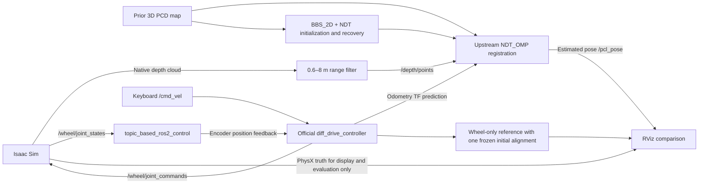

# Isaac Depth Localization

Estimate the position and orientation of a differential-drive robot in **Isaac Sim and ROS 2 Humble**, using a **prior 3D PCD map, depth-camera point clouds, and wheel encoder odometry**. RViz displays the estimated pose alongside independent simulation ground truth and a wheel-only reference.

Repository: [`ICPROJECT2026/isaac-depth-localization`](https://github.com/ICPROJECT2026/isaac-depth-localization).

The system uses existing open-source components: **NDT_OMP map registration, BBS_2D/NDT global initialization, and the official diff_drive_controller for wheel odometry**. This repository supplies the scene override layer, camera and joint connections, launch files, range filtering, visualization adapters, and experiment summaries. It does not introduce a custom point-cloud registration or wheel-odometry integration algorithm.

> This is a simulation research project. Short-recording replay comparisons and stationary alignment checks have been completed. Long routes, substantial dynamic occlusion, full recovery after loss of localization, and real-camera deployment still require validation. Isaac Sim, original scene assets, the 183 MB point-cloud map, and rosbags are not included.


## Contents

- [Features and status](#features-and-status)
- [Architecture and data flow](#architecture-and-data-flow)
- [Environment and dependencies](#environment-and-dependencies)
- [Installation and local resources](#installation-and-local-resources)
- [Launch and teleoperation](#launch-and-teleoperation)
- [RViz, topics, and TF](#rviz-topics-and-tf)
- [Key parameters](#key-parameters)
- [Results and validation limits](#results-and-validation-limits)
- [Map export and file formats](#map-export-and-file-formats)
- [Troubleshooting](#troubleshooting)
- [Repository layout](#repository-layout)
- [Contributing and licensing](#contributing-and-licensing)

## Features and status

| Feature | Status | Notes |
|---|---|---|
| Localization against an existing 3D PCD map | Integrated | The map is not rebuilt during localization. |
| Depth-camera PointCloud2 output | Integrated | Raw points come from Isaac's native ROS 2 Camera Helper. |
| Depth and point-cloud range filtering | Integrated | Axial depth outside 0.6–8 m is set to NaN. |
| Odometry from actual wheel-angle feedback | Integrated; initial calibration completed | The two driven rear wheels provide differential-drive odometry; the front passive wheel is excluded from integration. |
| Wheel-odometry prediction with NDT map corrections | Integrated | Prediction uses timestamped odometry TF without a second velocity integration path. |
| Global map-search initialization | Integrated; successful startup observed | BBS_2D candidates are checked with 3D NDT and repeated consistency tests. |
| Registration rejection guards | Integrated | Checks fitness and correction relative to the odometry prediction. |
| Recovery supervisor | Connected; full dynamic testing pending | Connection alone does not establish recovery in every degenerate scene. |
| Estimated pose, wheel-only pose, and ground-truth comparison | Integrated | Green, blue, and red in RViz. |
| IMU fusion | Not integrated | IMU input and preintegration are disabled. |
| Semantic removal of chairs/people or dynamic-object filtering | Not implemented | The current map retains objects exported from the scene. |
| Autonomous navigation, planning, and obstacle avoidance | Outside the current scope | Motion tests use manual keyboard control. |

## Architecture and data flow



**How the measurements are combined:** relative wheel-odometry motion predicts the pose for each incoming cloud. That prediction initializes registration against the map. An accepted registration corrects the global pose; when registration is rejected, wheel odometry can temporarily provide a predicted output. There is no additional EKF or IMU fusion in this configuration.

**Ground truth remains independent:** `/ground_truth/pose` comes from the PhysX rigid body's world transform and is used only for visualization and error evaluation. Historical wheel-separation calibration used ground truth for offline parameter fitting; the running localizer does not consume ground truth.

## Environment and dependencies

### Recorded experimental environment

| Component | Configuration used |
|---|---|
| Operating system | Ubuntu 22.04 x86_64 |
| ROS | ROS 2 Humble at `/opt/ros/humble` |
| Isaac Sim | Source build 6.1.0-rc.26; the course slides' 6.0.1 is not the version used here. |
| Python | System ROS Python 3.10 and Isaac's bundled Python 3.12, used separately. |
| GPU | NVIDIA RTX 4070 Laptop with 8 GB VRAM |
| ROS communication | `ROS_DOMAIN_ID=26`, `rmw_fastrtps_cpp`, `ROS_LOCALHOST_ONLY=0` |
| Units and coordinates | Meters, Z up; `map` uses the exported USD world coordinates. |

This table records the experimental environment, not minimum hardware requirements. Other Isaac Sim versions may require changes to extension names, OmniGraph nodes, or Python APIs.

### Upstream components

| Component | Role | Recorded version |
|---|---|---|
| [lidar_localization_ros2](https://github.com/rsasaki0109/lidar_localization_ros2) | Map localization, global search, lifecycle management, and recovery supervision | Commit `87b991693acbf00b64300a3e28e158ba95cbe220` |
| [ndt_omp_ros2](https://github.com/rsasaki0109/ndt_omp_ros2) | OpenMP NDT/GICP backend | Commit `0cc1621d5eab886569f6e7e36d115fcad894cd72` |
| [ros2_control / diff_drive_controller](https://control.ros.org/humble/doc/ros2_controllers/diff_drive_controller/doc/userdoc.html) | Differential-drive control and encoder odometry | controller_manager 2.54.3; diff_drive_controller 2.54.1 |
| [topic_based_ros2_control](https://github.com/PickNikRobotics/topic_based_ros2_control) | Topic-based joint hardware interface | 0.2.0 |
| RViz and teleop_twist_keyboard | Visualization and manual control | ROS Humble distribution packages |

The two source dependencies are pinned in [`dependencies.repos`](dependencies.repos). Third-party source trees, build outputs, and binary packages are not vendored here. APT installs the available Humble package versions, which may differ from those recorded above; record your installed versions when reproducing an experiment.

## Installation and local resources

### 1. Clone the repository

```bash
git clone https://github.com/ICPROJECT2026/isaac-depth-localization.git
cd isaac-depth-localization
```

Run subsequent commands from the repository root unless indicated otherwise. Install ROS 2 Humble and Isaac Sim first; this repository does not install either platform.

### 2. Install ROS and build dependencies

```bash
sudo apt update
sudo apt install -y \
  git build-essential cmake python3-dev pybind11-dev libpcl-dev \
  python3-colcon-common-extensions python3-vcstool python3-rosdep \
  python3-numpy python3-scipy python3-yaml python3-pil \
  ros-humble-rviz2 ros-humble-teleop-twist-keyboard \
  ros-humble-ros2-control ros-humble-ros2-controllers \
  ros-humble-topic-based-ros2-control ros-humble-rosbag2 \
  ros-humble-rmw-fastrtps-cpp
```

If rosdep has never been initialized on the machine, run `sudo rosdep init` once, then `rosdep update`. Do not repeat initialization on an already configured system.

```bash
bash scripts/fetch-upstream.sh
source /opt/ros/humble/setup.bash
rosdep install --from-paths ros_ws/src --ignore-src -r -y --rosdistro humble
cd ros_ws
colcon build --symlink-install --packages-up-to lidar_localization_ros2 \
  --cmake-args -DCMAKE_BUILD_TYPE=Release -DPython3_EXECUTABLE=/usr/bin/python3
cd ..
```

Use a Release build. With `pybind11-dev` and `python3-dev` installed, the build log should report compilation of `bbs_cpp` and `g2_ndt_score`. This configuration enables compiled search and NDT candidate scoring, so confirm that both modules were built.

`fetch-upstream.sh` does not reset existing checkouts. If reusing `ros_ws`, compare each dependency's `git rev-parse HEAD` with `dependencies.repos`. Following the latest main branch does not reproduce the pinned experiment.

### 3. Supply local scene and map files

| Resource | Suggested location | Included in Git? |
|---|---|---|
| Complete collected scene, materials, and textures | `assets/scene/Collected_final_wheeltec_with_scene/` | No; approximately 2 GB. |
| Cropped 2 cm PCD with the roof removed | `assets/maps/room.pcd` | No; 183,017,078 bytes and 11,438,552 points. |
| Auxiliary grid for BBS search | `assets/maps/room.yaml` and `room.pgm` | Yes; paired with the recorded room PCD. |
| Scale, camera, and wheel-joint override layer | `config/localization_scene.template.usda` | Yes. |

**Original scene assets and the PCD map are neither packaged nor distributed with this project.** Use files already available on your machine and pass their absolute paths to the configuration command below. The original collected scene directory must remain intact; keeping only its root USD file will break referenced resources.

See [`docs/ASSETS.md`](docs/ASSETS.md) for local resource requirements. [`assets/manifest.json`](assets/manifest.json) records hashes for the historical experiment's assets; it contains no scene or point-cloud content.

### 4. Generate local configuration

Replace the example paths with your installation and resource locations:

```bash
python3 scripts/configure.py \
  --isaac-root "$HOME/isaacsim/_build/linux-x86_64/release" \
  --scene "$PWD/assets/scene/Collected_final_wheeltec_with_scene/final_wheeltec_with_scene.usd" \
  --map "$PWD/assets/maps/room.pcd"
```

This generates `.env.local`, `runtime/*.local.yaml`, and `runtime/localization_scene.local.usda`, all ignored by Git. The local override layer references the original scene rather than overwriting it. At startup, the simulator saves its interface connections into this generated local layer.

Use `--occupancy` to select a matching auxiliary grid YAML and `--ros-overlay` to select another built workspace's `install/setup.bash`. The default overlay is `ros_ws/install/setup.bash` in this repository. Replacing the PCD requires a corresponding auxiliary grid; do not use the supplied room grid with an unrelated map.

Rerun configuration after moving the repository, changing local paths, or editing localization parameters in `config/`. Keep machine-specific paths out of shared YAML files and do not commit `.env.local`.

### 5. Check the repository files

```bash
python3 scripts/check-repository.py
```

The check covers Python/Bash syntax, YAML/URDF parsing, dependency locks, local documentation links, large files, and workstation-specific paths. It does not start Isaac, move the robot, or replace simulation testing. Packaging checks and historical localization accuracy are documented separately in [`docs/VALIDATION.md`](docs/VALIDATION.md).

## Launch and teleoperation

Open each terminal in the repository root and start the components in this order. The scripts configure system ROS and Isaac's bundled libraries separately; manual `LD_LIBRARY_PATH` changes are unnecessary.

| Terminal | Command | Expected state or purpose |
|---|---|---|
| 1 | `bash scripts/run.sh simulation` | Wait for scene loading and `LOCALIZATION_SCENE_READY`; the simulation enters Play. |
| 2 | `bash scripts/run.sh wheel` | Both official controllers activate and odometry updates with simulation time. |
| 3 | `bash scripts/run.sh localization` | Wait for `Localized from a map search.` before evaluating map localization. |
| 4 | `bash scripts/run.sh rviz` | Loads the saved visualization configuration. |
| 5 | `bash scripts/run.sh teleop` | Keep keyboard focus here for manual driving. |

Cold initialization may take tens of seconds; keep the robot stationary during initialization. Global search can fail. Initialization logs and `/alignment_status` provide more useful evidence of localization health than the mere presence of a pose arrow.

Default keyboard speeds are `0.1 m/s` linear and `0.3 rad/s` angular:

| Key | Action |
|---|---|
| `i` | Forward |
| `,` | Reverse |
| `j` / `l` | Turn left / right |
| `u` / `o` | Forward-left / forward-right arc |
| `k` | Stop |
| `Ctrl+C` | Exit the program in that terminal |

No test route is driven automatically. To record a manual test, run `bash scripts/run.sh record` in a sixth terminal. Stop it with Ctrl+C and let the bag close before reading it. Depth-cloud recordings can grow quickly; recordings are stored under the Git-ignored `data/` directory.

To shut down, stop the robot and exit teleoperation, then stop localization, controllers, and RViz, and finally close the simulator. Restarting Isaac resets simulation time: restart the other ROS processes too, to clear stale time and TF caches. Do not run an old controller or localizer from the original experiment directory at the same time.

## RViz, topics, and TF

### Display conventions

| Display | Meaning |
|---|---|
| Gray cloud | Prior static PCD map |
| Cyan cloud | Live depth points transformed into the map using the estimated TF |
| Green pose/trajectory | NDT localization with wheel-odometry prediction |
| Red pose | Independent PhysX world pose of the robot body |
| Blue pose/trajectory | Wheel-only odometry after one frozen initial map alignment |

After eight consecutive healthy registration statuses, the blue reference adapter freezes one `map → odom` alignment. Later point-cloud corrections do not change that reference. It does not subscribe to ground truth, reintegrate wheel angles, or feed an estimate back into the localizer. Its initial alignment still contains initialization error, so it is not an error-free independent global localization source.

Set RViz's **Fixed Frame** to `map`. Use the **Orbit** view for 3D inspection: left-drag to rotate, middle-drag to pan, and the wheel to zoom. The map remains fixed while the camera observes different surfaces as the robot moves.

### Main topics

| Topic | Type | Purpose |
|---|---|---|
| `/clock` | `rosgraph_msgs/msg/Clock` | Simulation time |
| `/depth/raw`, `/depth` | `sensor_msgs/msg/Image` | Raw and range-filtered depth; 32FC1 in meters |
| `/camera_info` | `sensor_msgs/msg/CameraInfo` | Camera intrinsics |
| `/depth/points_raw`, `/depth/points` | `sensor_msgs/msg/PointCloud2` | Raw and range-filtered camera points |
| `/wheel/joint_states` | `sensor_msgs/msg/JointState` | Actual simulated joint angles in radians |
| `/wheel/joint_commands` | `sensor_msgs/msg/JointState` | Joint commands produced by the controller |
| `/cmd_vel` | `geometry_msgs/msg/Twist` | Teleoperation velocity commands |
| `/wheel/odom` | `nav_msgs/msg/Odometry` | Wheel odometry from the official controller |
| `/pcl_pose` | `geometry_msgs/msg/PoseWithCovarianceStamped` | Estimated robot-body pose in the map |
| `/path` | `nav_msgs/msg/Path` | Estimated trajectory |
| `/initial_map` | `sensor_msgs/msg/PointCloud2` | Map visualization published by the localizer |
| `/alignment_status` | `diagnostic_msgs/msg/DiagnosticArray` | Registration state, fitness, prediction method, and rejection reason |
| `/ground_truth/pose` | `geometry_msgs/msg/PoseStamped` | Robot-body PhysX truth, for evaluation only |
| `/ground_truth/rear_axle_pose` | `geometry_msgs/msg/PoseStamped` | Rear-axle truth using the wheel-odometry reference point |
| `/wheel_reference/pose`, `/wheel_reference/path` | `PoseStamped` / `Path` | Blue wheel-only reference |
| `/sim/reference_odom` | `nav_msgs/msg/Odometry` | Original simulation odometry; diagnostic only, not a localization input |

Inspect small messages and connections with:

```bash
source scripts/setup-env.sh
ros2 topic list
ros2 topic echo /alignment_status --once
ros2 topic echo /pcl_pose --once
ros2 topic echo /ground_truth/pose --once
ros2 topic info /depth/points -v
ros2 run tf2_ros tf2_echo map base_link
```

Dumping an entire `/depth/points` message is not a useful alignment check. Inspect spatial alignment in RViz and verify timestamps, frame IDs, and TF.

### TF chain and ownership

```text
map
 └── odom                       localizer
      └── rear_axle             diff_drive_controller
           └── base_link        static axle-to-body transform
                └── camera_optical_frame   scene camera transform
```

`rear_axle` represents the midpoint of the two driven rear wheels, projected onto the body-height plane. `base_link` is approximately `0.12455 m` ahead of it. Treating them as the same point introduces a reference-point error during turns.

The recorded map's floor is around `Z=4.44 m`, not Z=0, and the initial body-height prior is approximately `4.48 m`. Do not assume that an RViz 2D Pose Estimate with Z=0 is valid for this map.

## Key parameters

Shared parameters live in `config/`; configuration adds local absolute paths to `runtime/*.local.yaml`.

| Parameter or geometry | Current value | Meaning |
|---|---:|---|
| Camera resolution | 640 × 480 | Approximation based on the supplied Astra Pro specifications |
| Horizontal / vertical field of view | Approximately 58.4° / 45.5° | Camera-model settings, not a calibration of a physical unit |
| Valid axial depth | 0.6–8 m | Filtering along the camera's optical Z axis |
| Registration radial range | 0.6–8.5 m | Separate distance-based registration filtering |
| Original map resolution | 2 cm | The PCD was not resampled as part of the NDT correction. |
| Registration voxel size | 7 cm | Processing parameter for registration inputs |
| Map visualization voxel size | 12 cm | Affects the map published for display only |
| NDT resolution / step / iterations | 0.3 m / 0.05 / 45 | Current experimental settings |
| Minimum cloud-processing interval | 0.33 s simulation time | Limits registration processing frequency |
| Fitness threshold | 0.003 m² | Rejects matches above the threshold; not a bound on pose error |
| Correction guard relative to odometry prediction | 0.08 m and 3° | Bounds a single registration correction, not robot motion |
| Geometric wheel radius | 0.0659684656 m | Driven wheels in this model |
| Geometric wheel separation | 0.3797898806 m | Separation of the driven rear wheels |
| Effective separation multiplier | 1.1288142582 | Fitted from manually driven arcs, not a geometric measurement |

`use_odom_tf_prediction: true` and `use_odom: false` are intentional: the official wheel-odometry TF supplies motion prediction while the other direct velocity-integration path is disabled. `use_odom: false` alone does not mean wheel odometry is unused.

Fitness is the mean squared nearest-map-point distance after registration. A smaller value indicates a better fit under that metric, but repeated structures or large planes can still yield a low score at an incorrect pose. A threshold of `0.003 m²` does not guarantee a robot-position error below 5.5 cm. The 8 cm / 3° correction guard also cannot prevent every accumulation of small biased corrections.

The scene was scaled using a reference table height of `0.8 m`; the override scale is approximately `0.10471185`. The camera is mounted about 15 cm above the floor, so tabletop upper surfaces are generally not visible. Localization depends on the wall corners, edges, and under-table structures actually observed by the camera.

## Results and validation limits

Three configurations were replayed on the same **665 depth clouds, approximately 143 s of simulation time, 0.68 m of travel, and a 22.4° heading range**, using the same BBS_2D + NDT initial pose:

| Configuration | XY RMSE | Maximum XY error | Yaw RMSE |
|---|---:|---:|---:|
| Original GICP configuration | 33.24 cm | 56.80 cm | 3.27° |
| GICP with registration guards | 7.32 cm | 9.21 cm | 0.77° |
| **NDT with registration guards, currently selected** | **4.50 cm** | **5.74 cm** | **0.13°** |


The NDT run reported 199 `ok` registration statuses and no rejections; the result was not obtained by disabling point-cloud corrections. Ground truth was removed from the tested input bag and used externally for evaluation. The previous localizer's `map → odom` transforms were also removed to avoid contaminating the comparison.

In a separate live stationary check, robot-position error decreased from approximately `1.81 m` to `0.046 m`. The median nearest-map-point distance for above-floor objects decreased from about `14.8 cm` to `2.04 cm`. **Point-to-map distance and robot-pose error are different metrics.**

These are archived experimental results, not measurements rerun after repository preparation. They do not establish accuracy on long routes, in crowds, or in every geometrically degenerate view. The original bag is not distributed with Git; it is required to fully replay the historical comparison. See [`docs/VALIDATION.md`](docs/VALIDATION.md) for further context.

### Possible next steps, not implemented

- Combine wheel odometry with an IMU gyroscope for better prediction during turns and brief occlusion; retain map matching for long-term drift correction.
- Prefer walls, columns, fixed tables, and cabinets in the localization map rather than frequently moved chairs.
- Reduce dynamic-point influence through robust matching and geometric consistency; RGB segmentation can assist without requiring perfect removal of every chair.
- Keep localization filtering separate from obstacle avoidance: people and chairs remain real obstacles even when excluded from localization.
- Reduce reliance on map corrections when stable geometry is insufficient, and validate recovery on repeated, varied routes.

## Map export and file formats

`tools/` contains scene-surface sampling, room-footprint cropping, and PLY-to-PCD conversion utilities. They operate on **complete authored USD geometry**, rather than a map reconstructed by driving a depth camera through the scene. Map colors encode height, not material textures.

After generating local configuration and supplying the original scene and its dependencies:

```bash
bash scripts/usd-python.sh tools/export-scene-pointcloud.py \
  --scene "$PWD/runtime/localization_scene.local.usda" \
  --output "$PWD/data/exported-map" --voxel 0.02

bash scripts/usd-python.sh tools/crop-scene-pointcloud.py \
  --source "$PWD/data/exported-map/scene_map.ply" \
  --scene "$PWD/runtime/localization_scene.local.usda" \
  --output "$PWD/data/exported-map/cropped"

python3 tools/ply-to-pcd.py \
  "$PWD/data/exported-map/cropped/房间范围_2cm_去顶板查看版.ply"
```

The final command uses the crop tool's actual output filename, which is retained for compatibility. The export and crop tools contain scene-specific prim paths and an 80 cm table-height check; they are not general converters for arbitrary USD scenes. Re-exported files should not be assumed to match archived hashes if the scene, parameters, or tool environment changes. PLY-to-PCD conversion checks that XYZ float bits and RGB bytes are preserved, without additional downsampling; it supports only the specific binary PLY field layout produced by these tools.

The CloudCompare 2.11.3 installation used in this experiment lacked a usable PCD reader. PLY files containing the same points were used for CloudCompare, while localization used PCD. Renaming an extension does not convert the format.

## Troubleshooting

**No topics, or `echo` waits indefinitely:** run `source scripts/setup-env.sh` in the current ROS terminal. Confirm domain 26, simulation Play, and camera rendering. A ROS domain groups DDS communication; nodes in different domains generally do not discover one another. The supplied scene also uses domain 26, so changing only the terminal is insufficient.

**Points are visible in RViz but do not align with the map:** check Fixed Frame `map`, the complete TF chain, consistent map/scene scale and origin, camera optical axes, and timestamps. Then inspect `/alignment_status`. A floor that appears aligned does not prove correct localization.

**Controllers do not activate:** first confirm updates on `/clock` and `/wheel/joint_states`, then inspect `/controller_manager/list_controllers`. The configured spawner timeouts are 60 s. Avoid starting a second controller_manager while troubleshooting.

```bash
ros2 service call /controller_manager/list_controllers \
  controller_manager_msgs/srv/ListControllers '{}'
```

**Large drift during turns:** distinguish the blue wheel-only reference from the green localization estimate. Check left/right wheel mapping, radian units, axle-to-body extrinsics, and `wheel_separation_multiplier`. If blue is stable while green jumps, investigate registration and geometric degeneracy. Do not feed ground truth into localization to conceal an estimation problem.

**Chairs move, or the camera sees only one wall:** semantic filtering is not implemented, and occluded surfaces cannot be recovered from missing observations. Repeated furniture, large planes, and a low camera viewpoint can reduce geometric constraints. An IMU improves motion prediction but cannot resolve incorrect geometric correspondences by itself.

**Parameter edits have no effect:** after editing `config/*.yaml`, rerun `scripts/configure.py` and restart the relevant nodes. Launch files read the generated `.local.yaml` files.

**Isaac reports Python or ROS library conflicts:** avoid manually adding system ROS Python paths to Isaac from a Conda or other activated environment. Use the supplied scripts: the range filter runs under system Python, while Isaac uses its bundled ROS library environment.

## Repository layout

```text
.
├── README.md
├── dependencies.repos          # Pinned commits for source dependencies
├── upstream-versions.json      # Upstream versions from the original experiment
├── config/                     # Shared localization/controller parameters and scene template
├── runtime/                    # Launch files, simulation connections, filtering, RViz, and URDF
├── scripts/                    # Local configuration, launch helpers, dependency fetch, and checks
├── tools/                      # USD surface export, cropping, and PLY-to-PCD conversion
├── assets/
│   ├── manifest.json           # Historical resource hashes; no asset content
│   ├── maps/                   # Auxiliary search grid; large PCD/PLY files are ignored
│   └── scene/                  # Optional local scene location; asset content is ignored
├── docs/
│   ├── ASSETS.md
│   ├── VALIDATION.md
│   ├── GITHUB_IMPORT.md
│   ├── images/                 # Alignment and error plots
│   └── results/                # Archived experiment summaries
├── data/                       # Recordings and exports, ignored by Git
├── logs/                       # Runtime logs, ignored by Git
└── .github/workflows/check.yml  # Static checks without ROS or a GPU
```

Earlier custom-localizer experiments, depth-only comparison launchers, local APT binaries, third-party build artifacts, and historical logs are excluded so that the repository presents the selected configuration consistently.

## Contributing and licensing

The supporting documents below are currently written in Chinese:

- Organization repository import: [`docs/GITHUB_IMPORT.md`](docs/GITHUB_IMPORT.md).
- Development and validation conventions: [`CONTRIBUTING.md`](CONTRIBUTING.md).
- Dependency attribution and licensing: [`THIRD_PARTY_NOTICES.md`](THIRD_PARTY_NOTICES.md).

The maintaining organization has not yet selected an open-source license for project-owned files. No MIT/BSD license is assigned on its behalf; select a license before an open-source release. Third-party software and original assets remain subject to their respective licenses.

References: [pinned upstream global-localization documentation](https://github.com/rsasaki0109/lidar_localization_ros2/blob/87b991693acbf00b64300a3e28e158ba95cbe220/docs/global_localization.md), [GitHub large-file documentation](https://docs.github.com/en/repositories/working-with-files/managing-large-files/about-large-files-on-github).
