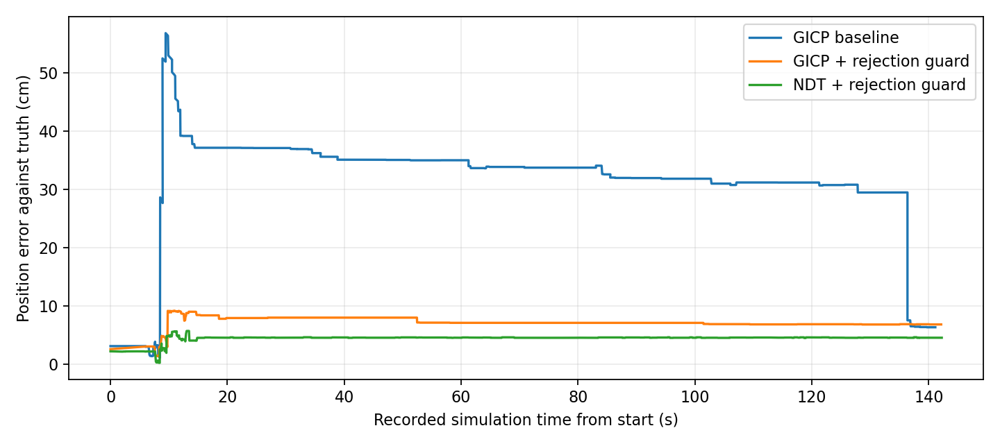
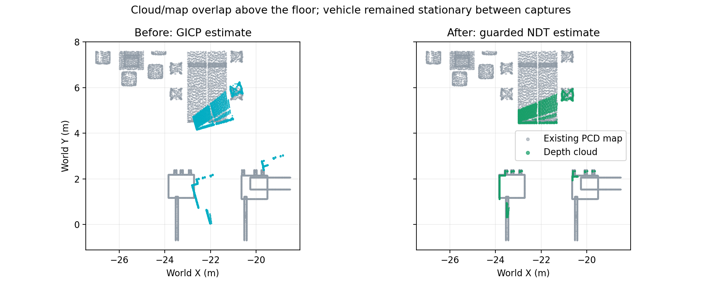

# 验证记录与复现边界

## 历史算法比较（2026-11-03）

历史记录标识：`cloud-comparison-20261103-215004`。约 143 秒仿真时间、665 帧点云、0.68094 m 路程、22.401° 航向范围。完整 bag 不在 Git 中。

处理规则：保持点云消息字节不变，移除旧估计结果和旧 `map → odom` TF；真值另存，仅用于输出误差评价。不同配置在独立 ROS 域回放相同输入，使用同一个上游 BBS_2D + NDT 搜索初值。

结果源文件：[`results/comparison.json`](results/comparison.json)。JSON 中 `source` 已替换为数据集标识，避免把原电脑绝对路径当作其他成员可用的数据地址。

| 配置 | XY RMSE | XY 最大误差 | 航向 RMSE |
|---|---:|---:|---:|
| 原 GICP | 0.332375 m | 0.568032 m | 3.268928° |
| GICP + 保护 | 0.073221 m | 0.092094 m | 0.774359° |
| NDT + 保护 | 0.044984 m | 0.057362 m | 0.126961° |

NDT 199 次状态均为 `ok`。严格保护并不等于无需正确初始化：较早一次从已经偏差约 13° 的轮 odom 先验启动时，原 GICP 错配，保护组没有完成初始化。该失败没有计为通过；后来才采用统一全局搜索初值比较。

## 静止线上检查

来源：[`results/repair-summary.json`](results/repair-summary.json)。车辆静止，相机几何及地图不变，使用修正前后估计位姿投影点云：车身位置误差约 1.81 m → 0.046 m；离地物体点云中位最近点距离约 14.8 cm → 2.04 cm。后者不是车辆位置误差。

## 轮 odom 标定的解释

几何轮距 0.3797898806 m、轮距倍率 1.1288142582。倍率由用户手动左右弧线记录拟合，不代表从实物测得更大的轮距。离线拟合误差不能代替独立动态测试。较早短测试中纯轮 odom 最大 XY 误差约 3.5 cm；更长时间后也曾积累约 23 cm 和 13° 误差。不能只引用最好的短时结果来声称 odom 长期准确。

## 代码整理后的检查

这次整理改变目录和本地路径加载方式，保留算法配置和上游 commit。准备阶段检查以下事项：

- Python 可解析、Bash 语法、YAML/URDF 格式和 README 本地链接。
- 生成本地配置后，PCD/栅格/场景引用正确，路径含空格时可以传递。
- 本地 `.env.local`、生成文件和大资源被 Git 忽略。
- 待上传文件中没有原电脑用户目录、录制数据或构建产物。
- 定位和控制依赖的版本清单一致。

**没有因此重新执行完整仿真路线。** CI 仅运行不依赖 GPU/ROS 的静态检查，不验证 NDT 数值精度、图像传感器输出或动态恢复。最终本地检查摘要保存在本文件旁的 `preparation-check.json`（若已生成）。

## 后续建议人工验证

每轮只改变一组参数，保留输入数据与版本信息。由操作者控制机器人，分别测试静止、直行、原地左右转、弧线转弯、视野退化后恢复、椅子位置变化，以及更长路线。记录绿色估计、蓝色轮 odom、红色真值及 `/alignment_status`。

如离线比较，不向被测节点回放真值或旧定位 TF；确保各方案初值和输入一致。统计位置/航向误差、拒绝率、最长失配时间、恢复耗时，而非只展示一次最好截图。自动恢复目前仍是待完整验证项。
